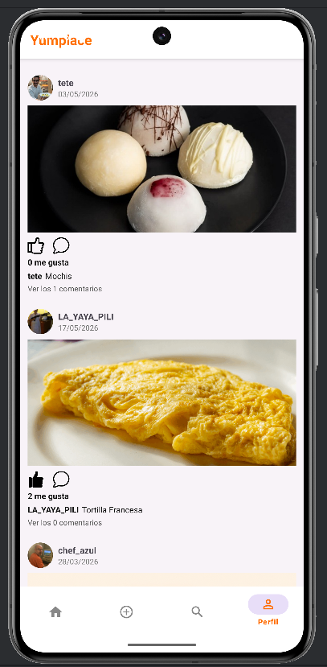
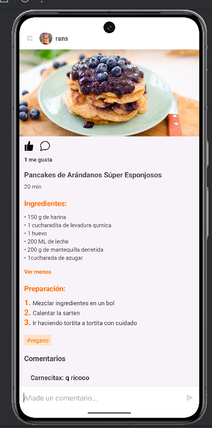
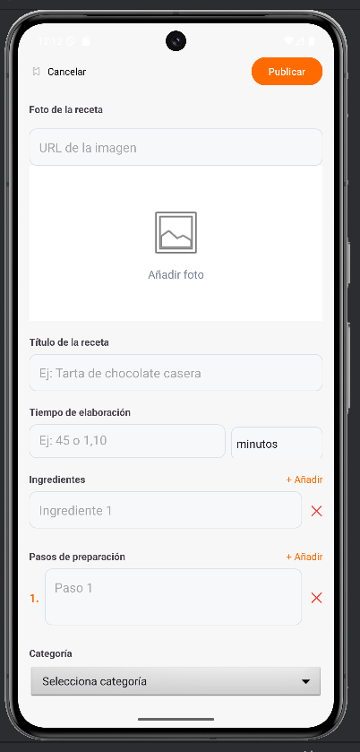
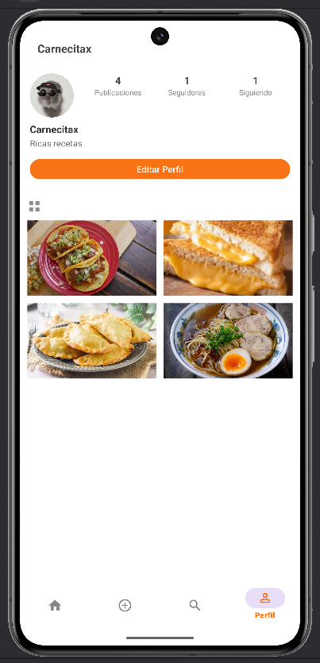

# 🍽️ Yumplace

## Tabla de Contenidos
- [Descripción](#descripción)
- [Instalación y ejecución](#instalación)  
- [Tecnologías](#tecnologías)  

## Descripción
Yumplace es una aplicación Android desarrollada como proyecto de final de ciclo de Desarrollo de Aplicaciones Multiplataforma (DAM).

La aplicación funciona como una red social gastronómica, donde los usuarios pueden compartir recetas, descubrir nuevas elaboraciones e interactuar con otros miembros de la comunidad.

El proyecto está desarrollado en Java para Android y se conecta a una API REST construida con Spring Boot, utilizando PostgreSQL como base de datos.

## 📸 Capturas de pantalla

### 🔐 Autenticación

La aplicación permite registrarse, iniciar sesión y recuperar la contraseña.

  
  
  

### 🍳 Recetas y publicaciones

Los usuarios pueden explorar recetas, consultar sus ingredientes y pasos de preparación, y crear nuevas publicaciones.

  
  
  

### 🔎 Búsqueda e interacciones

Es posible buscar recetas, filtrarlas por categorías, dar likes y publicar comentarios.

  

### 👤 Perfiles y comunidad

Cada usuario dispone de un perfil con sus publicaciones y puede consultar otros perfiles, seguir usuarios y editar su información personal.

  
  
  

## Instalación y ejecución

Requisitos
Android Studio.
Android SDK compatible con la configuración del proyecto.
Emulador Android o dispositivo físico.
Backend Yumplace en ejecución.

Pasos
- Clonar el repositorio: git clone https://github.com/trifuerza-Yumplace/Yumplace.git
- Abrir el proyecto Android en Android Studio.
- Esperar a que finalice la sincronización de Gradle.
- Configurar la conexión con el backend en RetrofitClient.java.
- Para el emulador oficial de Android: private static final String BASE_URL = "http://10.0.2.2:8082/";
- Iniciar el backend y ejecutar la aplicación desde Android Studio.

Nota: Yumplace funciona actualmente en un entorno de desarrollo local. No dispone de una versión pública desplegada.

## Teconologías | Uso

- Java --> Desarrollo de la aplicación Android
- Android Studio --> Entorno de desarrollo
- XML -->  Diseño de interfaces
- Retrofit --> Comunicación con la API REST
- JWT --> Autenticación mediante tokens
- Spring Boot --> Backend
- PostgreSQL --> Base de datos
- Supabase --> Alojamiento de PostgreSQL
- Git y GitHub --> Control de versiones y trabajo en equipo
