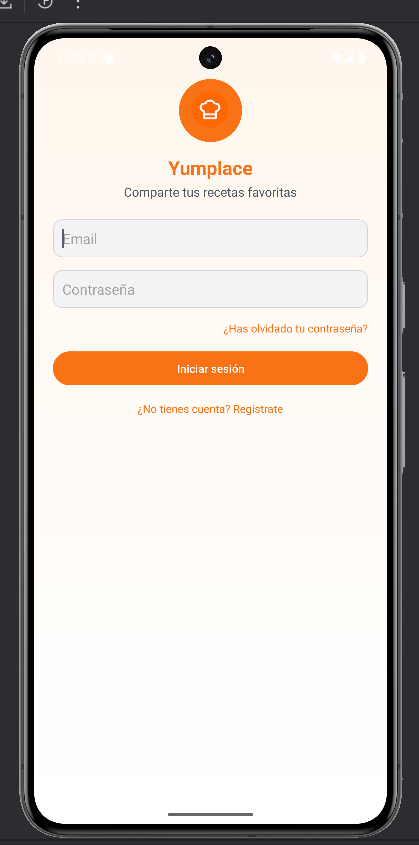
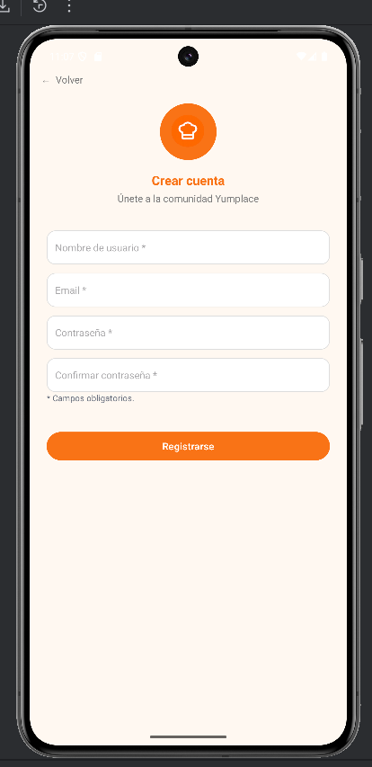
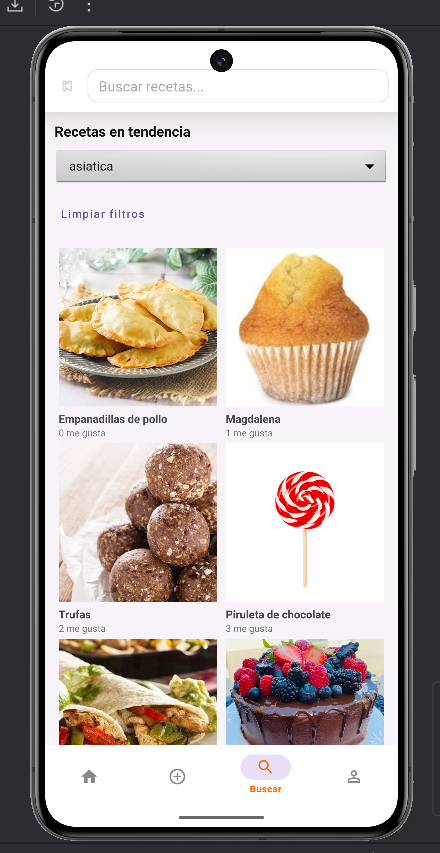
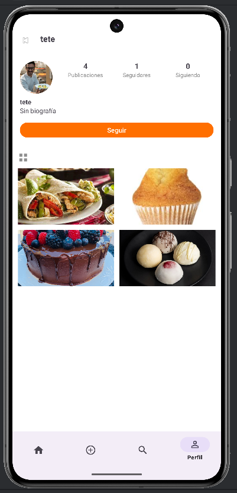
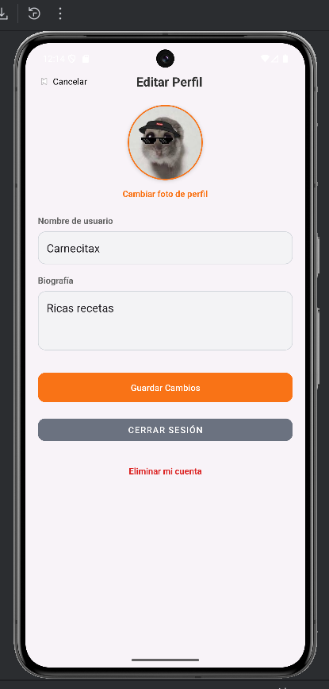

# 🍽️ Yumplace

<p align="center">
  
</p>

## Tabla de contenidos
- [Descripción](#descripción)
- [Funcionalidades](#funcionalidades)
- [Capturas de pantalla](#capturas-de-pantalla)
- [Tecnologías utilizadas](#tecnologías-utilizadas)
- [Arquitectura del proyecto](#arquitectura-del-proyecto)
- [Instalación y ejecución](#instalación-y-ejecución)

## Descripción
Yumplace es una aplicación Android desarrollada como proyecto de final de ciclo de Desarrollo de Aplicaciones Multiplataforma (DAM).

La aplicación funciona como una red social gastronómica, donde los usuarios pueden compartir recetas, descubrir nuevas elaboraciones e interactuar con otros miembros de la comunidad.

El proyecto está desarrollado en Java para Android y se conecta a una API REST construida con Spring Boot, utilizando PostgreSQL como base de datos.


## Funcionalidades

- **Autenticación:** registro, inicio de sesión y recuperación de contraseña.
- **Publicaciones:** creación de recetas con imágenes, ingredientes, pasos, categorías y tiempos de preparación.
- **Feed:** visualización de recetas compartidas por otros usuarios.
- **Interacciones:** likes y comentarios en las publicaciones.
- **Detalle de recetas:** consulta de ingredientes y pasos, con opciones para expandir y contraer contenido.
- **Búsqueda:** exploración de recetas y filtrado por categorías.
- **Perfiles:** visualización y edición del perfil propio, así como consulta de perfiles ajenos.
- **Comunidad:** seguimiento de otros usuarios y consulta de sus publicaciones.

## Capturas de pantalla

### Autenticación

La aplicación permite registrarse, iniciar sesión y recuperar la contraseña.

<p align="center">
  
  
  
</p>

### Recetas y publicaciones

Los usuarios pueden explorar recetas, consultar sus ingredientes y pasos de preparación, y crear nuevas publicaciones.

<p align="center">
  
  
  
</p>

### Búsqueda e interacciones

Es posible buscar recetas, filtrarlas por categorías, dar likes y publicar comentarios.

<p align="center">
  
</p>

### Perfiles y comunidad

Cada usuario dispone de un perfil con sus publicaciones y puede consultar otros perfiles, seguir usuarios y editar su información personal.

<p align="center">
  
  
  
</p>

## Tecnologías utilizadas

| Tecnología | Uso |
|---|---|
| Java | Desarrollo de la aplicación Android |
| Android Studio | Entorno de desarrollo |
| XML | Diseño de interfaces |
| Retrofit | Comunicación con la API REST |
| JWT | Autenticación mediante tokens |
| Spring Boot | Backend y lógica de negocio |
| PostgreSQL | Base de datos relacional |
| Supabase | Alojamiento de PostgreSQL |
| Git y GitHub | Control de versiones y colaboración |


## Arquitectura del proyecto

Yumplace utiliza una arquitectura cliente-servidor:

- **Frontend:** aplicación Android desarrollada en Java y XML.
- **Backend:** API REST desarrollada con Java y Spring Boot.
- **Base de datos:** PostgreSQL alojada en Supabase.
- **Comunicación:** peticiones HTTP mediante Retrofit.
- **Autenticación:** basada en tokens JWT.

El backend se mantiene en un repositorio privado, ya que el proyecto fue desarrollado en equipo.

La aplicación requiere que la API esté en funcionamiento para utilizar las funcionalidades conectadas al servidor.


## Instalación y ejecución

### Requisitos

- Android Studio.
- Android SDK compatible con la configuración del proyecto.
- Emulador Android o dispositivo físico.
- Backend Yumplace en ejecución.

### Pasos

1. Clonar el repositorio:

   ```bash
   git clone https://github.com/trifuerza-Yumplace/Yumplace.git
   ```

2. Abrir el proyecto en Android Studio.

3. Esperar a que finalice la sincronización de Gradle.

4. Configurar la conexión con el backend en `RetrofitClient.java`.

   Para utilizar el emulador oficial de Android:

   ```java
   private static final String BASE_URL = "http://10.0.2.2:8082/";
   ```

5. Iniciar el backend y ejecutar la aplicación desde Android Studio.

> **Nota:** Yumplace funciona actualmente en un entorno de desarrollo local y no dispone de una versión pública desplegada. El backend se mantiene privado, por lo que su ejecución requiere acceso autorizado.
